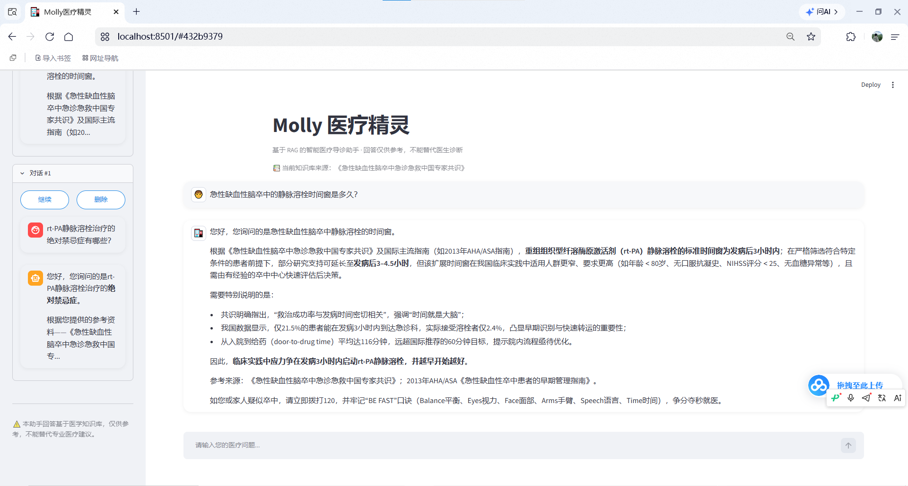
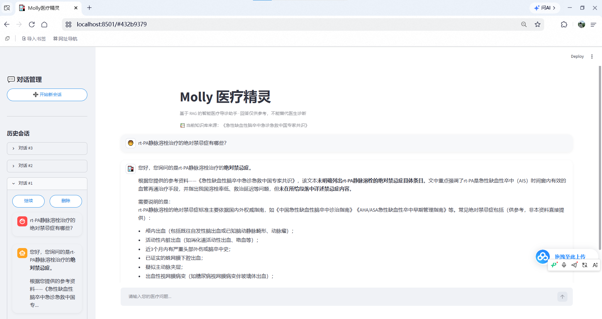

# Molly 医疗精灵 (Molly Medical Assistant)

基于 RAG（检索增强生成）的智能医疗导诊助手。

## ✨ 功能特性
- **本地知识库**：挂载《急性缺血性脑卒中急诊急救中国专家共识》PDF，精准回答医疗问题。
- **防幻觉设计**：基于 ChromaDB 向量检索，回答中自动标注“参考资料”，拒绝随意编造。
- **多轮对话记忆**：使用 SQLite 持久化聊天记录，支持多会话切换与历史回溯。
- **流式输出**：基于 FastAPI/Streamlit 实现流式输出，等待时有“正在检索医学知识库”的交互反馈。

## 🚀 运行步骤
1. 克隆代码：
   `git clone https://github.com/fengshengzhen/molly-medical-assistant.git`
2. 安装依赖（建议使用 Python 3.11 虚拟环境）：
   `pip install -r requirements.txt`
3. 配置 API Key：
   - 在根目录新建 `.env` 文件。
   - 填入你的 Key：`QWEN_API_KEY=你的通义千问Key`
   - （可选）填入 `OPENAI_API_KEY=你的DeepSeek Key`
4. 启动项目：
   `streamlit run main.py`

## 📷 运行截图

## 📝 个人备注
- 开发过程中遇到的最大坑是 Qwen 的 Embedding 接口不支持 token 列表，后来加上 `check_embedding_ctx_length=False` 才解决。
- 本项目是我的个人练习与简历展示作品，欢迎交流指正。
